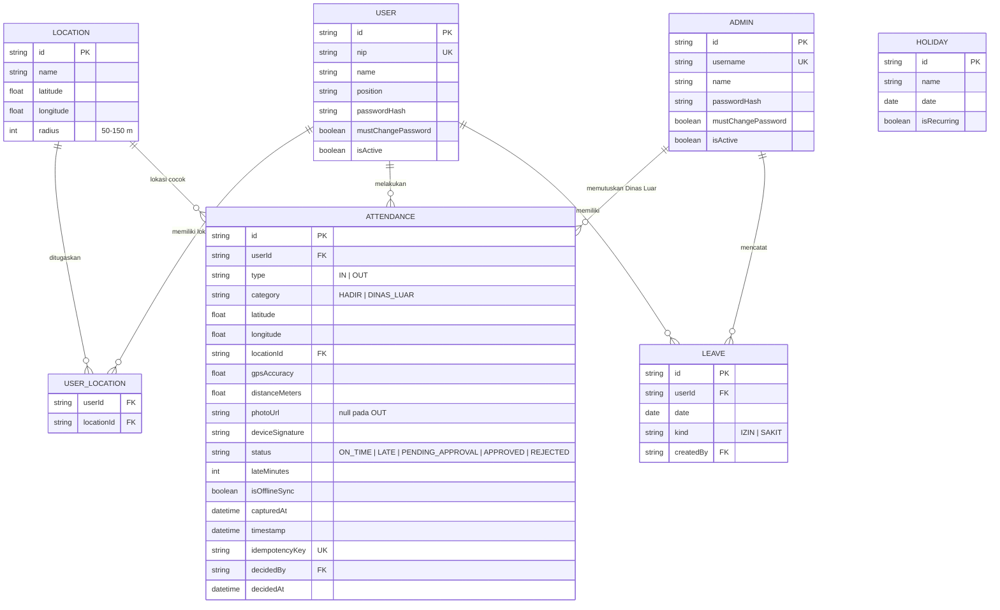
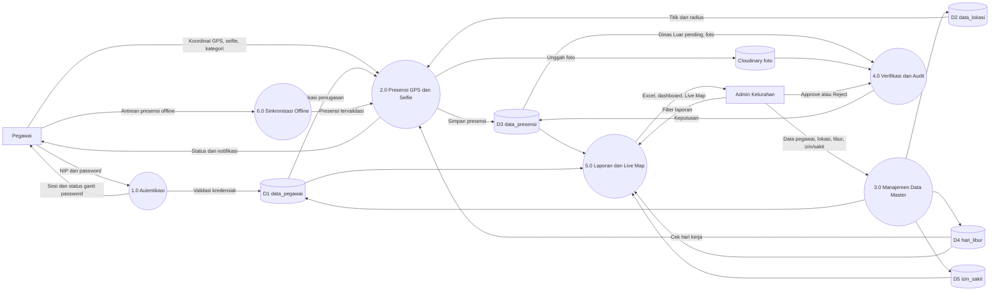
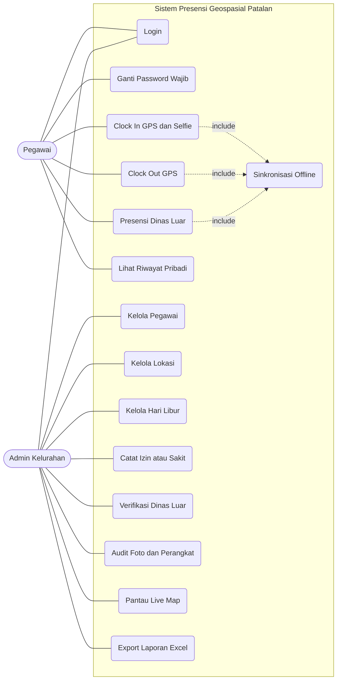

# Diagram Terbaru (selaras PRD v3.5 dan OpenSpec)

Menggantikan `erd.jpg`, `dfd level 1.drawio.png`, dan `usecase diagram.drawio.png` yang belum memuat Lokasi, Holiday, Dinas Luar, Izin/Sakit, Verifikasi, dan Offline. DFD level 0 masih berlaku. Render dengan Mermaid (VS Code, mermaid.live, atau draw.io via Insert > Advanced > Mermaid).

## 1. ERD

## 2. DFD Level 1

## 3. Use Case

