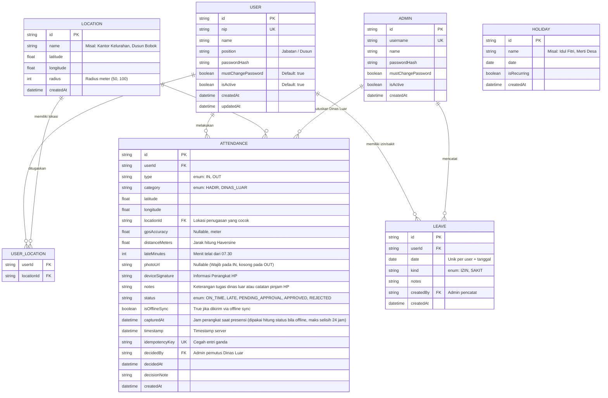

# Product Requirements Document (PRD)

**Nama Produk:** Sistem Presensi Geospasial Multi-Lokasi & Selfie Kelurahan Patalan  
**Versi:** 3.5 (Production-Ready Edition; menyelaraskan keputusan di `openspec/project.md`)  
**Dokumen:** Spesifikasi Kebutuhan Perangkat Lunak / PRD

---

## 1. Pendahuluan

### 1.1 Tujuan Produk

Membangun sistem presensi digital berbasis web (Mobile PWA & Web Desktop) untuk aparatur Kelurahan Patalan yang memvalidasi kehadiran secara matematis (**Algoritma Haversine**), visual kedinasan (**Live Selfie Foto Formal pada Clock In**), dan kemudahan kepulangan (**Clock Out Cukup GPS Tanpa Foto**), dengan dukungan **Multi-Zone Geofencing** (kantor vs padukuhan), **Kategori Dinas Luar**, penyimpanan media cloud **Cloudinary (25GB)**, serta strategi ketersediaan tinggi (**Warmup Keep-Alive & Offline-First**).

### 1.2 Target Pengguna (User Personas)

1. **`PEGAWAI` (Pamong Kantor, Dukuh, Ketua RT):** Mengakses sistem via smartphone untuk melakukan presensi masuk/pulang/dinas luar di lokasi tugas masing-masing.
2. **`ADMIN` (Pengelola Sistem Kelurahan):** Mengakses sistem via laptop/komputer kantor untuk mengelola akun pegawai, lokasi padukuhan, kalender libur, verifikasi dinas luar & audit foto, serta mencetak laporan kedinasan.

---

## 2. Kebutuhan Fungsional (User Stories)

### 2.1 Modul Otentikasi & Akun Onboarding (Auth.js v5)

- **Akun Dibuatkan oleh Admin:** Tidak ada registrasi publik. Admin mendaftarkan akun pegawai baru dengan NIP, Nama, Jabatan, dan Lokasi Penugasan.
- **Default Password & Wajib Ganti Password:** Password bawaan akun baru adalah NIP pegawai. Pada saat login pertama kali, sistem otomatis mengarahkan pegawai ke halaman **Ganti Password Wajib** sebelum bisa mengakses fitur presensi (`mustChangePassword: true`).
- **Fleksibilitas Perangkat (Soft Device Tracking):** Pegawai diperbolehkan login dari perangkat lain jika HP-nya rusak/lowbat/pinjam pasangan. Sistem mencatat `deviceSignature` untuk audit transparansi admin (tanpa blokir).

### 2.2 Modul Presensi Pegawai (Mobile PWA)

- Dashboard Bento Grid menampilkan jam real-time, status kehadiran hari ini, dan indikator lokasi penugasan.
- **Aturan Jam Kerja & Toleransi Keterlambatan:**
  - **Senin – Kamis:** 07.30 – 15.30 WIB.
  - **Jumat:** 07.30 – 14.30 WIB.
  - **Toleransi Telat (Grace Period):** 15 Menit. Presensi masuk $\le$ 07.45 WIB tercatat `ON_TIME`. Presensi masuk $>$ 07.45 WIB tercatat `LATE` (otomatis menghitung selisih menit keterlambatan).
  - Aturan ini berlaku seragam untuk pamong kantor, Dukuh, dan RT.
- **Perbedaan Alur Clock In vs Clock Out:**
  1. **Clock In (Absen Masuk):**
     - Wajib berada di radius penugasan (validasi Haversine server-side).
     - Wajib foto selfie formal berbusana dinas rapi (bingkai oval ramah pamong sepuh).
     - Pembubuhan watermark digital permanen (WIB, Lat/Long, NIP, Hash).
     - Kompresi WebP (~150KB / ~50KB) dan diunggah ke Cloudinary.
  2. **Clock Out (Absen Pulang):**
     - Wajib berada di radius penugasan (validasi Haversine server-side).
     - **TIDAK PERLU FOTO SELFIE** (cukup 1-klik tombol absen kepulangan berbasis GPS, menghemat kuota pegawai dan mempercepat alur pulang).
- **Kategori Presensi:**
  - `HADIR`: WFO / Wilayah (terikat radius geofence).
  - `DINAS_LUAR`: Boleh di luar radius, wajib upload foto kegiatan dinas + catatan tugas (status: `PENDING_APPROVAL`).
- **Offline-First Mode:** Jika sinyal putus di pelosok dusun, data tersimpan di IndexedDB HP dan disinkronkan otomatis via Background Sync saat online.
- Pegawai dapat melihat riwayat kehadiran bulanan pribadinya.

### 2.3 Modul Manajemen Lokasi Penugasan (Admin)

- Admin dapat mengelola Master Lokasi (CRUD): Nama Lokasi (Kantor Kelurahan, Padukuhan Bobok, dsb), Koordinat (Lat/Long), dan Radius (50m - 150m).
- Admin menetapkan lokasi target untuk setiap pegawai.

### 2.4 Modul Kalender Kerja & Manajemen Hari Libur (Admin)

- Admin dapat mengelola Master Hari Libur (CRUD): Menandai tanggal merah nasional dan cuti/event lokal desa (Merti Desa).
- Sistem otomatis menonaktifkan kalkulasi status "Alpha" pada hari libur dan akhir pekan.

### 2.5 Modul Pemantauan, Audit Visual, & Verifikasi Dinas Luar (Admin)

- Dashboard Bento Grid menampilkan metrik kehadiran harian: Total Hadir, Terlambat, Dinas Luar, Izin, Alpha.
- **Audit Visual Foto Formal & Auto-Face Crop:** Admin meninjau foto wajah Clock In pegawai dengan thumbnail auto-crop Cloudinary (`c_thumb,g_face`).
- **Label Transparansi Perangkat:** Menampilkan badge informatif jika sebuah HP digunakan oleh multi-akun pada hari yang sama.
- Modul Verifikasi: Admin dapat meninjau dan menyetujui (_Approve_) atau menolak (_Reject_) pengajuan presensi Dinas Luar pegawai.
- Live Presence Map (Leaflet.js) menampilkan sebaran geofence kantor/padukuhan dan pin kehadiran riil pegawai hari ini.

### 2.6 Modul Laporan & Rekapitulasi Excel Kedinasan (Admin)

- Filter data berdasarkan rentang tanggal, status, atau unit padukuhan.
- **Format Export Excel (.xlsx) Standar Kedinasan:**
  Kolom: `[No | NIP | Nama | Jabatan/Dusun | Total Hadir | Total Terlambat (menit) | Dinas Luar | Izin/Sakit | Alpha | % Kehadiran]`.

### 2.7 Modul Ketersediaan & Health Check (`/api/health`)

- Endpoint health check ringan untuk keep-alive Vercel Serverless & Neon PostgreSQL via cron ping berkala (bebas cold-start).

### 2.8 Batasan Arsitektur & Mitigasi Teknis Produksi

1. **Leaflet.js Dynamic Import:** Komponen peta diimpor dengan `ssr: false` untuk mitigasi error `window is not defined` pada App Router.
2. **Auth.js JWT Edge Session:** Menggunakan strategi sesi JWT agar Edge Middleware dapat memverifikasi otentikasi tanpa menyentuh koneksi database Prisma di edge environment.
3. **Dual Connection String Neon:** `DATABASE_URL` untuk pooled runtime (PgBouncer) dan `DIRECT_URL` untuk migrasi Prisma.
4. **Direct Signed Upload Cloudinary:** Pengunggahan foto selfie dilakukan langsung dari browser ke Cloudinary via Signed Preset untuk melewati batas payload 4.5MB Vercel.
5. **HTTPS Development Requirement:** Pengujian kamera dan GPS pada perangkat fisik mobile wajib menggunakan HTTPS tunnel (Cloudflare Tunnel/Ngrok).
6. **Keputusan Tambahan (v3.5):**
   - Izin/Sakit dicatat manual oleh Admin per tanggal (entitas `LEAVE`).
   - Menit keterlambatan dihitung dari 07.30. Alpha = hari kerja tanpa Clock In, tanpa Izin/Sakit, tanpa Dinas Luar `APPROVED`.
   - Lupa Clock Out dibiarkan kosong, tetap dihitung hadir, dan ditandai di laporan. Clock Out Dinas Luar tidak terikat radius.
   - Presensi immutable (tidak ada edit/hapus oleh admin pada v1).
   - Rate limit login 5 gagal / 15 menit. Foto dihapus otomatis setelah 1 tahun.
   - Admin disimpan di tabel `ADMIN` terpisah dari pegawai (login username, tanpa lokasi). Pegawai dapat memiliki lebih dari satu lokasi penugasan (`USER_LOCATION`).
   - Perangkat didukung: Android, iOS, Windows.

---

## 3. Entity Relationship Diagram (ERD)

